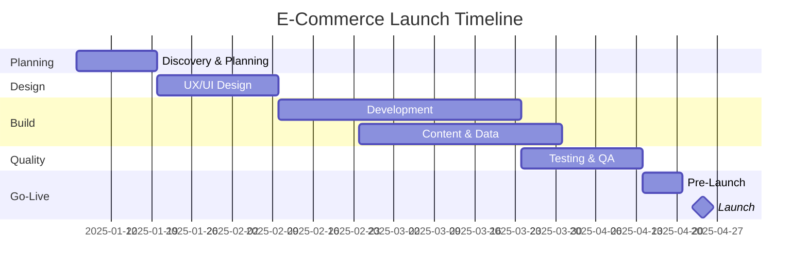

# E-Commerce Website Launch — Project Plan

## Table of Contents
1. [Project Overview](#1-project-overview)
2. [Goals & Success Metrics](#2-goals--success-metrics)
3. [Scope](#3-scope)
4. [Team & Responsibilities](#4-team--responsibilities)
5. [Timeline & Phases](#5-timeline--phases)
6. [Milestones](#6-milestones)
7. [Technology Stack](#7-technology-stack)
8. [Budget Estimate](#8-budget-estimate)
9. [Risk Management](#9-risk-management)
10. [Launch Checklist](#10-launch-checklist)
11. [Post-Launch Plan](#11-post-launch-plan)
12. [Communication Plan](#12-communication-plan)

---

## 1. Project Overview

**Project name:** E-Commerce Website Launch
**Duration:** 16 weeks
**Objective:** Design, build, and launch a secure, scalable, mobile-friendly online store that lets customers browse products, place orders, and pay online, backed by tools for inventory, order, and customer management.

---

## 2. Goals & Success Metrics

| Goal | KPI | Target (first 90 days) |
|------|-----|------------------------|
| Drive online sales | Monthly revenue | Hit the agreed revenue baseline |
| Convert visitors | Conversion rate | ≥ 2.5% |
| Retain customers | Repeat purchase rate | ≥ 20% |
| Deliver a fast experience | Page load time (LCP) | < 2.5 s |
| Keep the site reliable | Uptime | ≥ 99.9% |
| Reduce cart abandonment | Abandonment rate | < 65% |

---

## 3. Scope

### In Scope
- Product catalog with categories, search, and filters
- Product detail pages with images, reviews, and stock status
- Shopping cart and guest/registered checkout
- Payment gateway integration (cards, digital wallets)
- User accounts: registration, login, order history, wishlist
- Admin dashboard: products, inventory, orders, discounts
- Shipping and tax calculation
- Transactional emails (order confirmation, shipping updates)
- SEO basics, analytics, and responsive/mobile design
- Accessibility to WCAG 2.1 AA

### Out of Scope (Phase 2)
- Native mobile apps
- Multi-currency / multi-language support
- Marketplace (third-party sellers)
- Loyalty program

---

## 4. Team & Responsibilities

| Role | Responsibilities |
|------|------------------|
| Project Manager | Planning, schedule, budget, stakeholder updates |
| Product Owner | Requirements, backlog priorities, acceptance |
| UX/UI Designer | Wireframes, prototypes, visual design |
| Frontend Developer(s) | Storefront UI, responsiveness, performance |
| Backend Developer(s) | APIs, database, integrations, admin |
| QA Engineer | Test plans, functional/regression/performance testing |
| DevOps Engineer | Hosting, CI/CD, monitoring, backups |
| Security Specialist | Threat review, PCI-DSS compliance, pen testing |
| Marketing Lead | SEO, launch campaign, email and social |
| Content Writer | Product copy, policies, landing pages |
| Customer Support Lead | Support processes, FAQ, training |

---

## 5. Timeline & Phases

| Phase | Weeks | Key Activities | Deliverables |
|-------|-------|----------------|--------------|
| **1. Discovery & Planning** | 1–2 | Stakeholder interviews, competitor analysis, requirements, tech selection | Requirements doc, project charter |
| **2. Design** | 3–5 | Sitemap, wireframes, UI design, prototype usability tests | Approved designs and style guide |
| **3. Development** | 6–11 | Frontend, backend, payment/shipping integrations, admin panel | Feature-complete staging site |
| **4. Content & Data** | 8–12 | Product data import, imagery, copywriting, legal pages | Populated catalog, policies |
| **5. Testing & QA** | 12–14 | Functional, cross-browser, mobile, performance, security, UAT | QA sign-off, defect log closed |
| **6. Pre-Launch** | 15 | Production setup, DNS/SSL, data migration, staff training, soft launch | Go/no-go decision |
| **7. Launch** | 16 | Public launch, marketing campaign, close monitoring | Live website |
| **8. Post-Launch** | 17+ | Hypercare, bug fixes, optimization | Performance report |

---

## 6. Milestones

| # | Milestone | Target Week | Owner |
|---|-----------|-------------|-------|
| M1 | Requirements signed off | 2 | Product Owner |
| M2 | Designs approved | 5 | UX/UI Designer |
| M3 | Payment integration complete | 9 | Backend Lead |
| M4 | Feature-complete on staging | 11 | Dev Lead |
| M5 | Catalog fully loaded | 12 | Content Writer |
| M6 | QA & UAT sign-off | 14 | QA Engineer |
| M7 | Go/no-go decision | 15 | Project Manager |
| M8 | Public launch | 16 | All |

---

## 7. Technology Stack

| Layer | Options |
|-------|---------|
| Platform | Shopify / WooCommerce / custom build (e.g., Next.js + Node.js or Django) |
| Database | PostgreSQL / MySQL |
| Payments | Stripe, PayPal |
| Hosting / CDN | AWS, Vercel, or Cloudflare |
| Search | Algolia or Elasticsearch |
| Email | SendGrid / Mailchimp |
| Analytics | Google Analytics 4, Hotjar |
| Monitoring | Sentry, uptime monitoring, log aggregation |
| CI/CD | GitHub Actions |

---

## 8. Budget Estimate

| Category | % of Budget |
|----------|-------------|
| Design & Development | 45% |
| Platform, Hosting & Licenses | 10% |
| Content & Photography | 8% |
| QA & Security Testing | 10% |
| Marketing & Launch Campaign | 20% |
| Contingency | 7% |

---

## 9. Risk Management

| Risk | Likelihood | Impact | Mitigation |
|------|-----------|--------|------------|
| Scope creep | High | High | Formal change-request process; Phase 2 backlog |
| Payment integration delays | Medium | High | Start early; use well-documented gateway; sandbox testing |
| Security breach / data leak | Low | Critical | PCI-DSS compliance, HTTPS, OWASP Top 10 review, pen test |
| Performance issues under load | Medium | High | Load testing, CDN, caching, autoscaling |
| Incomplete product data | Medium | Medium | Content owners and deadlines set in Week 1 |
| Key staff unavailable | Medium | Medium | Documentation, cross-training |
| Launch-day outage | Low | High | Soft launch, rollback plan, on-call rota |

---

## 10. Launch Checklist

### Technical
- [ ] SSL certificate installed; HTTPS enforced
- [ ] Payment gateway switched to live mode and tested with a real transaction
- [ ] Backups and disaster recovery verified
- [ ] Monitoring, alerting, and error tracking active
- [ ] Load test passed at expected peak traffic ×3
- [ ] Redirects (301) in place if migrating from an old site
- [ ] Sitemap.xml and robots.txt configured

### Content & Legal
- [ ] Privacy policy, terms of service, returns & refund policy published
- [ ] Cookie consent banner (GDPR/CCPA)
- [ ] All product data, prices, and images verified
- [ ] Contact and support pages live

### Business & Operations
- [ ] Shipping rates and tax rules verified
- [ ] Order fulfillment workflow tested end-to-end
- [ ] Support team trained; FAQ published
- [ ] Analytics and conversion tracking verified
- [ ] Marketing campaign scheduled (email, social, ads)

---

## 11. Post-Launch Plan

| Timeframe | Activities |
|-----------|-----------|
| Days 1–14 (Hypercare) | Daily monitoring, fast bug fixes, daily stand-ups |
| Weeks 3–6 | Analyze funnel data, fix UX friction, A/B test checkout |
| Months 2–3 | SEO improvements, email automation (abandoned cart, win-back) |
| Quarter 2 | Start Phase 2 features based on customer feedback |

---

## 12. Communication Plan

| Audience | Channel | Frequency | Owner |
|----------|---------|-----------|-------|
| Core team | Stand-up meeting | Daily | Project Manager |
| Stakeholders | Status report | Weekly | Project Manager |
| Executive sponsor | Steering review | Bi-weekly | Project Manager |
| Whole company | Launch announcement | At launch | Marketing Lead |
| Customers | Email / social media | Launch + ongoing | Marketing Lead |

---

The End
